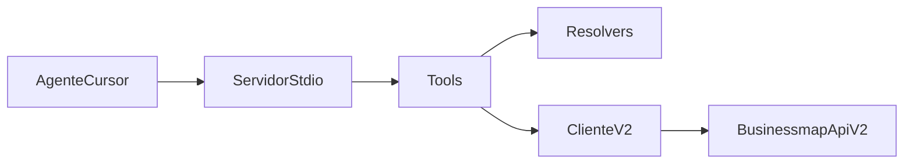

# MCP Kanbanize (fac-apropriacao-mcp)

Workspace deste plano: `D:\Factory\Saude\fac-apropriacao-mcp` (já criado; agente já apontado para cá). Nada deste trabalho altera [fac-apropriacao](D:\Factory\Saude\fac-apropriacao). O C# fica como especificação de domínio, não como biblioteca.

O script do Kiro nesta máquina está em `C:\Users\joao.dare\Downloads\cursor-kiro-workflow\scripts\kiro-review.sh` (não em `~/.cursor/scripts`). Ele só roda dentro de um git repo e grava `.ai-reviews/`. Por isso a ordem é: `git init`, `AGENTS.md` e a spec, **consult**, e só então código. Review/challenge/task exigem um commit com diff; o commit só sai se você pedir.

## O que entra agora

Servidor MCP stdio em TypeScript (`@modelcontextprotocol/sdk` + Zod), Node 20. Chave só por ambiente (`KANBANIZE_API_KEY`, `KANBANIZE_SUBDOMAIN` default `grupofacil`). Header `apikey`. A chave nunca é argumento de tool, log ou resposta.

Ferramentas, com nomes em português e respostas curtas (id, título, board, coluna, raia, dono, prioridade, campos nome/valor, horas):

- Leitura: `whoami`, `listar_boards`, `buscar_cards`, `obter_card`, `listar_campos`, `listar_horas`
- Escrita: `lancar_horas`, `alterar_horas`, `excluir_horas`, `criar_card`, `atualizar_card`

Fora desta entrega: mover card, comentário, cronômetro, encerrar reunião FAC, checklist de saída e lançar hora em nome de outra pessoa.

## Regras copiadas do FacApropriação

Fonte: [Kanbanize/Service.cs](D:\Factory\Saude\fac-apropriacao\Kanbanize\Service.cs), [BoardStructureColumnResolver.cs](D:\Factory\Saude\fac-apropriacao\Kanbanize\BoardStructureColumnResolver.cs), [BoardStructureLaneResolver.cs](D:\Factory\Saude\fac-apropriacao\Kanbanize\BoardStructureLaneResolver.cs), [HomeController.cs](D:\Factory\Saude\fac-apropriacao\FacApropriacao\Controllers\HomeController.cs) (por volta da linha 2119, `Tempo / 3600`).

- Na v2, `time` é **segundos**. A tool fala horas. `segundos = round(horas * 3600)`, mínimo 0,01 h (36 s), máximo 6.000.000 s. Não repetir o `PUT` atual, que manda horas no campo `time`.
- Data futura é recusada. Data no formato `YYYY-MM-DD`.
- Board, coluna, raia, tipo e campo customizado resolvem por nome (case-insensitive). Coluna e raia respeitam o `workflow_id`. Nome com ponto usa o último segmento, como o resolver C#.
- Dropdown: texto da opção vira `value_id` quando a API exigir id (`allowedValues` do board e, se vazio, o global).
- `buscar_cards` exige board ou id. Página limitada (100). Se o filtro for título, ocorrência ou WBS e a API não filtrar no servidor, filtrar na página e avisar truncamento. Não varrer todos os boards.
- `lancar_horas` grava no usuário da chave (`GET /api/v2/me`). Sem `user_id` de terceiro.
- Erros `RL02` (retry com `retry_after`), `ARU5` e `C191` viram frase curta em português, sem corpo cru nem chave.
- `PATCH` é parcial. Não reenviar a descrição inteira ao mexer em campo, salvo se o OpenAPI da conta mostrar que o campo é apagado quando omitido. Conferir `https://grupofacil.kanbanize.com/openapi/json` na hora de fixar `comment` vs `description` e o body de `POST /cards`.

## Layout

- `src/index.ts` — servidor stdio
- `src/config.ts` — env
- `src/kanbanize/client.ts` — fetch, retry `RL02`, erros
- `src/kanbanize/time.ts`, `resolvers.ts`, `errors.ts`
- `src/tools/*.ts` — um arquivo por grupo
- `test/` — Vitest, sem rede: conversão de horas, resolução de nome, parse de erro, body de lançamento em segundos
- `scripts/check.sh` — `tsc` + testes (quality gate do Kiro)
- `.env.example`, `.gitignore` (`.env`, `dist`, `.ai-reviews`)
- `AGENTS.md` — domínio, comandos, “não logar API key”
- `.kiro/specs/mcp-v1/tasks.md` — critérios de aceite para o modo task
- `README.md` — como buildar e o bloco do `mcp.json` do Cursor (`node dist/index.js`), sem chave real

Nenhuma key de [AppTeste/Program.cs](D:\Factory\Saude\fac-apropriacao\AppTeste\Program.cs) entra no projeto novo.

## Kiro

Consult (até 15 linhas, antes do `src/`):

Servidor MCP TypeScript em fac-apropriacao-mcp, stdio, API v2 apenas, chave só em env. Tools: whoami, boards, buscar/obter card, campos, listar/lançar/alterar/excluir horas, criar e atualizar card. Horas na tool, segundos na API. Nomes resolvem para ids. Sem mover card, sem cronômetro, sem hora de terceiro. Testes unitários sem rede. Não logar a chave.

- Exit 2 ou 3: parar e explicar.
- `VERDICT: FAIL`: parar e mostrar o ponto fraco.
- `PASS` ou `NEEDS_DISCUSSION`: em até 5 linhas, o que muda, e seguir.

Depois do código: `review`. Se o diff tocar chave ou o cliente HTTP, `challenge`. Em seguida `task` em `.kiro/specs/mcp-v1/tasks.md`. Achados vão para triagem (`kiro-log.sh`); P0 não se corrige sem você decidir. O `review` precisa de commit; peço antes de rodá-lo.
